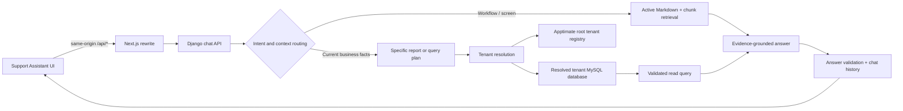

# Apptimate Support Assistant: Admin Analytics System Map

**Audit date:** 2026-10-23  
**Scope:** Repository and local-runtime inspection of `support-assistant/`, the tenant database path, the shared UI/menu registry, and the knowledge-generation path. This is not a certification of remote production settings. I connected through the local app's configured tenant resolver and ran read-only checks against the local tenant database.

## Purpose

This document describes how an admin question should flow from the chat UI to the right source: verified product documentation, tenant-specific live records, or a focused clarification. It also records the current architecture, confirmed gaps, and a practical route to dependable cross-module analytics.

## System at a glance

### Repositories and main components

| Area | Location | Role |
|---|---|---|
| Support UI | `support-assistant/ui/src/app/page.tsx` | Chat, sessions, source references, knowledge document upload/activation, and chunk inspection. |
| UI API proxy | `support-assistant/ui/next.config.ts` | Rewrites `/api/*` to Django at `SUPPORT_ASSISTANT_API_URL`, default `http://127.0.0.1:8008/api`. |
| Support API | `support-assistant/api/assistant/views.py` | Chat orchestration, tools, data reports, document endpoints, history, and response metadata. |
| Intent routing | `support-assistant/api/assistant/intents.py`, `query_service.py` | Deterministic recognition of common workflows, reports, and question types. |
| Live tenant access | `support-assistant/api/assistant/db_service.py` | Tenant resolution and specialized MySQL reads. |
| Schema query planner | `support-assistant/api/assistant/query_service.py` | Schema inspection, safe query-plan validation, and bounded cross-module read queries. |
| Documentation retrieval | `support-assistant/api/assistant/rag_service.py`, `chunking_service.py` | Markdown chunking, embeddings, navigation retrieval, and semantic retrieval. |
| Assistant policy | `support-assistant/api/assistant/prompts.py` | Tool selection, grounding, scope, and answer-writing instructions. |
| Tenant application | `apps/api/app/Modules/` | Laravel domains: Construction, Core, CRM, Finance, HR, Inventory, Jewelry, Money Exchange, Procurement, Production, Reporting, and Sales. |
| Menu registry | `packages/core-lib/src/constants/menus.ts` | Registered screen labels, routes, modules, and default groups. |
| Generated product knowledge | `support-assistant/api/build_full_platform_knowledge.py` and `generate_full_knowledge.py` | Produce/update the Markdown knowledge corpus from selected source files. |

## UI and HTTP flows

### Chat

1. The UI posts a chat message to `/api/chat/` through the Next.js rewrite.
2. The request includes the user/session identifiers and tenant identifier. Current UI code hardcodes `username = "support_user"` and `tenantDomain = "localhost"`; the API also accepts `X-Tenant-Domain`, `X-Tenant-Id`, and body tenant fields.
3. `chat_query` classifies the question, loads recent turns, and chooses documentation retrieval, a deterministic report, or model tool calls.
4. The response includes answer text, usage, confidence metadata, and retrieved references. Session history is stored in Django’s SQLite database.

### Knowledge documents

The UI calls `/api/documents/`, `/api/documents/upload/`, `/api/documents/activate/`, `/api/documents/<id>/chunks/`, and `/api/documents/<id>/delete/`. Uploading indexes Markdown into `UploadedDocument` and `DocumentChunk` rows. One document is selected as active for retrieval. Navigation references can be synchronized from the menu registry.

### Other support API routes

The API is mounted below `/api/`. Every view below is currently marked `csrf_exempt`; views enforce their HTTP method in application code.

| Route | Method | Function | Data/action |
|---|---|---|---|
| `/api/chat/` | POST | `chat_query` | Routes help retrieval and tenant-scoped live read queries. |
| `/api/history/` | GET | `chat_history` | Reads chat turns for a caller-supplied username/session. |
| `/api/sessions/` | GET | `chat_sessions` | Lists sessions for a caller-supplied username. |
| `/api/sessions/delete/` | POST | `delete_session` | Deletes turns for a caller-supplied username/session. |
| `/api/documents/` | GET | `document_list` | Lists all local knowledge documents. |
| `/api/documents/upload/` | POST | `document_upload` | Saves, indexes, and activates an uploaded Markdown/text file. |
| `/api/documents/activate/` | POST | `document_activate` | Changes the active knowledge source. |
| `/api/documents/<id>/chunks/` | GET | `document_chunks` | Returns indexed document content. |
| `/api/documents/<id>/delete/` | POST or DELETE | `document_delete` | Deletes a document and its chunks/file. |
| `/api/auth/register/` | POST | `register_user` | Creates a Django user. |
| `/api/auth/login/` | POST | `login_user` | Checks a Django username/password and returns JSON. |

The UI does not call login/register and still supplies the literal username `support_user` and tenant domain `localhost`. A successful login response does not establish a browser session or authorize subsequent chat/document calls. These endpoints therefore do not currently establish a verified admin identity or tenant permission boundary.

## Tenant resolution and database boundaries

`db_service.resolve_tenant_database()` resolves a tenant domain/identifier against the central root database, verifies the tenant, normalizes the database name to `apptimate_<tenant_id>`, and falls back to `DEFAULT_TENANT_ID` if resolution fails. `get_tenant_connection()` accepts only names matching that tenant database format. The generic-query SQLAlchemy engine applies the same database-name check.

The data path still relies on an identifier supplied by the UI/request, and repository inspection did not establish an authenticated identity-to-tenant authorization check in `chat_query`. An unregistered explicit identifier now fails instead of silently falling back to the default tenant. A missing identifier uses the configured default only when `ALLOW_DEFAULT_TENANT` is enabled; this defaults on in debug mode and off in non-debug mode. An admin analytics deployment should derive tenant and user permissions from the authenticated application session, not trust a client-supplied tenant header by itself.

The support assistant’s own data store is SQLite and contains uploaded documents, embeddings, and chat logs. Business records live in the locally configured Laravel tenant MySQL database for local runs, or the resolved tenant MySQL database in a deployed multi-tenant run. These are separate stores and have different access/configuration paths. The support UI proxies to Django locally, and `db_service.py` reads MySQL settings from the support API process environment; verify that this process uses the same local DB host/port and tenant registry as the Apptimate API before diagnosing missing live data.

#### Local live-data verification (2026-10-23)

The local Next.js UI was running at `http://localhost:3008/`; its proxy targets the local Django API. The UI showed tenant `apptimate_infinity` and an active knowledge base with 713 chunks. Using the same API process environment and tenant resolver, read-only queries reached `apptimate_infinity` successfully. This confirms the locally connected business database path works; it does not validate a remote deployment.

No per-item quantities from the previous local snapshot are retained here as verified tenant facts. The earlier threshold counts, item names/SKUs, and below-Max result list were reported as false and have been removed. Verify any such answer from a fresh tenant-scoped query with the requested organization, item status, soft-delete, warehouse, variant, unit, and NULL/zero semantics applied; do not reuse historical chat output as live evidence.

#### Previously implemented changes (current verification status below)

- Added a deterministic item-master Min/Max Qty summary and a direct below-Max Qty report. Both use active, non-deleted items and positive configured values; every returned below-Max row is checked again before formatting.
- Added typo normalization for `mster` and concatenated “maximumquantity” phrasing, plus regression coverage for these real query forms.
- Truncated record lists now return a direct partial-result explanation without a second model summary. Grouped aggregates are treated as potentially truncated; only scalar aggregate results with no `GROUP BY` bypass the row-limit warning.
- Fixed PO follow-up intent for wording such as “why for Vitamin C”; the purchase answer still goes through its evidence review.
- Explicit unknown tenant identifiers now fail rather than returning the default tenant. Port-bearing local hostnames are normalized before registry lookup. Default-tenant use is enabled by default only in debug mode and can be explicitly controlled with `ALLOW_DEFAULT_TENANT`.
- Removed the checked-in MySQL root/password fallback. The API now requires `MYSQL_USER` and `MYSQL_PASSWORD`; Django debug mode, secret key, allowed hosts, and CORS origins use environment configuration.
- Added tenant-resolution and inventory-routing regression tests.

**Verification status:** The earlier 109-test report and live threshold snapshot are historical and do not verify the current code or tenant facts. The current purchase-channel update has had Python syntax and scenario-catalog structure checked; the application test suite and live inventory queries have not been run for this change.

## Question routing contract

| Question class | Correct source | Expected behavior |
|---|---|---|
| Screen location, field meaning, or documented workflow | Active help corpus and verified menu reference | Answer only from matching documented sections; say exactly what evidence is missing when there is no match. |
| Current count, configuration, item, customer, invoice, balance, or transaction | Tenant live data | Call a specialized report or validated schema query. Never substitute documentation or a generic overview for missing fields. |
| Analytics across modules or arbitrary dimensions | Validated structured query plan | Use actual tenant schema/foreign keys, bind values, apply requested filters/date boundaries, and state aggregation scope. |
| “Can I buy 19 Vitamin C?” with no transaction channel | Focused clarification, then carry the original item and quantity into the selected flow | A reply such as “for customer sale” routes to live item sale eligibility and stock. Compare the request against a single active warehouse and the applicable variant/batch/serial scope. A supplier-PO reply routes to the PO diagnostic. Never substitute PO evidence or item-master Max Qty for customer-sale availability. |
| Explicit customer sale, including “Can I sell 20 watches to a single customer?” | Item sale eligibility and live stock | Parse the requested quantity/item, normalize ordinary plurals such as “watches” to “watch,” and compare stock for the applicable warehouse, variant, unit, batch, or serial. Exclude synthetic LD-* load-test rows from catalog matching. Never use item-master Max Qty as a sale limit. |
| Explicit supplier purchase / PO | Purchase-order diagnostic and validated PO rules | Check supplier/warehouse/item prerequisites and state what the validator does and does not establish. |
| Vague but answerable request | Conversation context plus question semantics | Infer ordinary shorthand/typos; ask a focused clarification only if multiple materially different queries remain. |
| No tenant access, schema error, or query error | Error path | Say lookup failed and identify the missing access/data condition; do not report an empty result as zero. |

Current routing includes special cases for item stock, minimum/maximum threshold reports, sales growth, supplier history, warehouses, and purchase-order diagnostics. Bare “can I buy/purchase …” wording is now separated from explicit customer-sale and supplier-order contexts: the bare wording gets a focused clarification, and a short channel reply inherits the original item and quantity before selecting the customer-sale stock tool or supplier-PO diagnostic. Customer-sale replies are formatted from the matched live record: only active, sales-enabled, non-variant stock at one active warehouse is compared as a direct stock check; organization, batch, variant, and serial scope are preserved. A positive stock check is not a reservation or guarantee that checkout will succeed. Other live requests use the model’s query_business_data plan. Intent patterns live across both intents.py and query_service.py, so adding a new intent in only one location can route it incorrectly.

## Live query design

### Specialized tools

`db_service.py` has tenant-scoped tools for common item/stock, inventory overview, warehouses, below-minimum stock, below-maximum stock, item-master threshold counts, and supplier checks. `views.py` formats these results and, for deterministic reports, bypasses model answer generation. The minimum, maximum, and configuration summaries now filter to non-deleted `status = 'active'` items and only count positive threshold values. Regression tests cover typo-tolerant Max Qty lookup, exact stock-to-Max Qty comparison, row validation, and follow-up routing.

### Generic `query_business_data`

1. `_schema_for()` reads the connected tenant’s `INFORMATION_SCHEMA` and declared foreign keys. Metadata is cached for ten minutes, up to eight tenant databases.
2. Schema output omits selected credential/session/assistant tables and sensitive-looking columns.
3. `_relevant_tables()` ranks schema tables by words/synonyms in the question, then adds nearby FK tables. The model receives up to 16 ranked tables, up to 60 columns per table, and at most 30 join hints.
4. The model returns a structured plan, not SQL. The server validates identifiers against the schema, requires declared FK joins, validates aggregates/operators, binds filter values, limits joins to five, selected fields to twelve, filters to twenty, and result rows to 500.
5. SQLAlchemy `text()` executes the compiled parameterized SELECT through a pooled engine for the resolved tenant database. Existing specialized paths continue to use PyMySQL. The application query compiler only emits SELECTs, but the database account is configured by the general MySQL user/password and its database-level read-only grant has not been verified.
6. Validation errors may trigger one model repair attempt. Answer validation checks the result against the user request and returned evidence.

This is more flexible than a list of prebuilt report names, but it is not yet a complete analytics semantic layer. Names such as “sales,” “net revenue,” “stock,” “available,” “customer,” and “active” can have module-specific meanings. Schema joins alone do not establish correct accounting treatment, void/cancelled status handling, tax inclusion, unit conversion, or date semantics.

## Database and business semantics to document

The following must be explicit in a trusted metric catalog or specialized query before claiming universal analytics coverage:

- **Inventory:** distinguish on-hand, allocated, available, reserved, and in-transit; define warehouse/organization scope; respect variants, batches, serials, and unit conversions.
- **Item thresholds:** `inventory_items.min_stock_level`, `max_stock_level`, `reorder_point`, and `reorder_qty` are separate. The item form converts empty/zero threshold input to `NULL`; for user-facing “configured” counts the current report treats positive values as configured. Confirm this convention with the business owner before expanding it to every report.
- **Sales:** document invoice/POS/order/return/credit-note source tables, status inclusion, net versus gross, discounts, tax, refunds, and comparison dates.
- **Purchasing:** distinguish ordered, approved, received, invoiced, paid, and remaining values; item/supplier associations must come from actual purchase documents, not active supplier catalog rows.
- **Finance:** define posted versus draft journals, void/reversal handling, currency conversion, fiscal period, and account balance signs.
- **People and payroll:** restrict reports to permitted roles and aggregate or mask personal/salary information as dictated by existing authorization policy.
- **Cross-module joins:** prefer declared foreign keys and vetted metric definitions; avoid joining facts at different grains without de-duplication rules.

## Documentation and evidence flow

`chunking_service.py` splits Markdown by headings and paragraphs, stores hierarchy breadcrumbs, and requests embeddings from the configured embedding provider. `rag_service.py` retrieves semantic top-K chunks; navigation queries use lexical matching against route-bearing evidence. Chat responses retain reference metadata in `ChatUsageLog` and return it to the UI.

Product knowledge files currently include `support-assistant/api/uploads/apptimate_one_deep_knowledge.md` and `sales_deep_knowledge_v68.md`; another copy exists under `support-assistant/uploads/`. Multiple uploaded/active versions can drift. Generated knowledge must be checked against current Laravel controllers, requests, resources, migrations, and UI components before it is treated as authoritative. Menu registry entries prove destinations only; they do not prove screen fields or workflow actions.

## Confirmed system risks and gaps

### P0 — Admin identity and tenant authority

- The support UI hardcodes a generic username and localhost tenant.
- Chat and document views are marked `csrf_exempt`. Django now reads debug mode, host allowlists, CORS origins, and its secret key from environment configuration; local defaults are limited to localhost. Non-debug startup requires an explicit secret key and host allowlist.
- The inspected chat flow accepts tenant identifiers from request headers/body and did not demonstrate admin-role authorization.
- Do not expose tenant-wide financial, HR, customer, or user analytics to an “admin” until the application authenticates the user and checks tenant/role/permission server-side.
- MySQL connections now require `MYSQL_USER` and `MYSQL_PASSWORD`; the checked-in root/password fallback was removed. Production must use a least-privilege database principal; its database grants still need verification.
- The UI still uses the generic username `support_user`, login does not establish a session, and all document APIs remain unauthenticated. Document upload, activation, chunk reading, and deletion therefore need admin authorization before deployment beyond a trusted local environment.

### P1 — Query correctness and semantics

- Live intent recognition is distributed among regex helpers and hand-written view branches. Natural wording, typos, concatenated terms, and follow-ups can miss the intended data tool.
- A schema-valid query can still use the wrong business definition. Evidence validation can reject an answer but cannot repair absent schema, wrong metric semantics, or incorrect tenant selection.
- Schema hints are capped and relevance-ranked; a relevant table/column may be omitted, causing a false “field unavailable” conclusion.
- Fixed report endpoints can drift from live migrations or older tenant schemas. They need explicit capability checks and clear partial-support results.
- Treat zero/null according to each field’s UI/write semantics; do not copy one threshold’s rule to unrelated quantities.

### P1 — Runtime and deployment

- Support API configuration is loaded from environment variables and an `.env` file. `requirements.txt` declares SQLAlchemy, which must be installed in the deployed support API environment for generic schema-query execution.
- The local API's configured tenant resolver and tenant database were read-tested successfully. This does not certify remote hosts, production credentials, grants, or tenant routing.
- No health check currently demonstrated here verifies root-DB connectivity, tenant-DB connectivity, schema discovery, embedding provider, chat completion provider, and active-doc indexing together.

### P2 — Retrieval and answer UX

- Semantic top-K retrieval can omit the one exact section needed for a question; add lexical/high-signal retrieval for field names, route labels, and report definitions.
- Confidence UI labels retrieval/evidence metadata. Do not display 100% merely because a query succeeded; distinguish source existence, query completeness, and business interpretation correctness.
- On a genuine failure, return a concrete next action: missing tenant header, database unavailable, requested table/column absent, ambiguous period/entity, or permission denied. Do not repeatedly ask for item name when a request is an aggregate over all items.

## Recommended target design

1. **Authenticated request context:** derive `tenant_id`, user, roles, and permissions from the application’s signed/authenticated session. Reject missing/unauthorized context. Do not trust the UI’s tenant string as authorization.
2. **One routing result object:** classify into `documentation`, `specialized_report`, `generic_analytics`, `clarification`, or `unsupported`, with extracted entities, metrics, period, filters, and confidence. Avoid separate regex decisions in multiple call sites.
3. **Metric registry:** define vetted business metrics, fact grain, date column, status filters, units, joins, and null/zero rules for sales, stock, purchasing, finance, and HR.
4. **Schema/metadata service:** discover actual tenant columns and FKs; cache by tenant plus schema version; tell the model when a field is unavailable instead of silently truncating the schema.
5. **Structured query planner:** model emits JSON plan only. Validate fields/joins against tenant schema and metric registry, bind values, enforce SELECT-only database credentials, timeouts, row/scan limits, and aggregate limits. Keep write endpoints unreachable from analytics.
6. **Result verification:** verify requested metric/filter/date/unit and total/row completeness before natural-language formatting. Distinguish zero rows from failed/incomplete queries.
7. **Conversation memory:** carry forward only user-provided entities and explicit filters. A new request replaces stale metric/domain context. Ask only for genuinely missing values.
8. **Evidence and audit:** record tenant, user identity, intent, metric ID, plan, tables/columns, filters (redacted as needed), execution status, row count, truncation, and response evidence. Do not store database credentials or unnecessary sensitive values in prompts/logs.
9. **Operations:** health endpoint and startup checks for MySQL driver/SQLAlchemy, root DB, tenant resolution, tenant query, active knowledge doc, embedding provider, and chat model. Surface deployment/config failures distinctly.

## Acceptance checklist for admin analytics

- [ ] Authenticated user and tenant are derived server-side; permissions are checked per module and sensitive field.
- [ ] Every supported metric has a documented definition and source tables/columns.
- [ ] Natural paraphrases and common typos route to the same intent; aggregate requests do not demand a named item.
- [ ] Date ranges use explicit tenant timezone and inclusive/exclusive boundaries documented per query.
- [ ] SQL values are bound; identifiers/joins are schema-validated; database principal is read-only.
- [ ] Unknown metric, missing column, permission denial, DB outage, and empty result are different outcomes.
- [ ] Output labels units, filters, period, tenant scope, and whether results were truncated.
- [ ] Answers never claim tenant configuration or counts from static documentation alone.
- [ ] Security review confirms chat, document upload/activation, history, CORS, CSRF, and admin authorization behavior.
- [ ] Evaluation covers each business module, cross-module joins, follow-ups, prompt injection in retrieved text/data, null/zero, and failures.

## Operational references

- Support API routes: `support-assistant/api/assistant/urls.py`
- Chat orchestration: `support-assistant/api/assistant/views.py`
- Live DB connector and specialized reports: `support-assistant/api/assistant/db_service.py`
- Intent and generic query validation: `support-assistant/api/assistant/intents.py`, `support-assistant/api/assistant/query_service.py`
- Prompt/tool policy: `support-assistant/api/assistant/prompts.py`
- Retrieval and navigation: `support-assistant/api/assistant/rag_service.py`, `support-assistant/api/assistant/navigation_reference.py`
- Main API routing: `apps/api/routes/`, `apps/api/app/Modules/*/Routes/`
- Inventory item schema: `apps/api/database/migrations/tenant/Inventory/2026_05_19_000005_create_items_tables.php`
- Inventory item validation/UI: `apps/api/app/Modules/Inventory/Requests/StoreItemRequest.php`, `UpdateItemRequest.php`, `apps/common-ui/inventory-ui/app/items/_route/components/ItemList.tsx`

